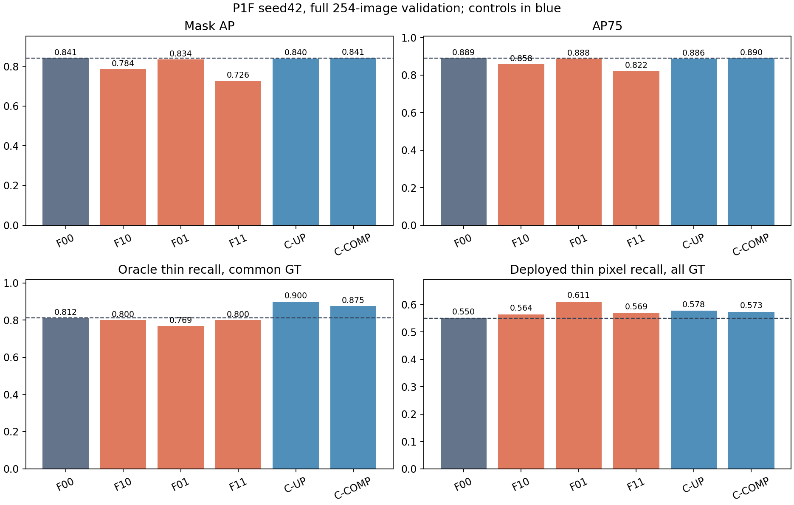

> **原生研究记录**：保留当时的方法、数值与判断；只适配路径和链接。历史命令及未收录依赖不能直接运行，草案/计划不等于已执行结果。见 [发布说明](../../docs/PROVENANCE.md)。

# EXP-SIS-20260922-P1F 最终报告

## P1F VERDICT

**F. GENERIC CAPACITY EFFECT — `STOP` prototype-resolution line。**

三种子 exact64/full254 复现均达到冻结的 `STRONG`；这确认 P1E 所见局部 thin prototype 上限可重复。归因实验没有支持更细 source 或 learned 320×320 lattice 的独立收益。F10、F01、F11 都没有同时胜过 F00 的部署指标；三种子扩展 gate 为 `STOP-DEVELOPMENT-EXTENSION`。C-UP 和 C-COMP 的 oracle ceiling 比 F00 高，但 C-UP 的部署 AP 略低，C-COMP 才是算力匹配控制且其边界 F 略低于 F00。结果更符合插值/通用生成器容量影响，不能据此提出 spatial-lattice 方法。该判断限于注册的 seed42 归因实验；没有 basis-rank 或多种子 factorial 数据。

没有触发 P1G blueprint、basis-rank 训练或 20–30 篇 targeted novelty search 的前置条件。历史阶段结论保持冻结：P1A=E、P1B=A+STOP、P1C=F/PIVOT、P1D=H/STOP、P1E=C/GO。

## 复制门槛与设计

P1F-0 复用了 P1D BASE60 seeds 42/128/2024 的最终 checkpoint；exact64 中 2/3 通过核心 gate，full254 中 2/3 通过，seed42 exact 结果与 P1E 完全一致。`THIN_CAPACITY_REPLICATION=STRONG`、`FULL_VAL_REPLICATION=STRONG`，因此才开始训练。家族范围检查中 YOLOv8 与 YOLO26 各只有 15 个 thin GT，低于冻结的 20 个最低样本量，结论为 `INCONCLUSIVE`。

六个 seed42 变体都按 60 epochs 完成；每个 completion 收据中的 last checkpoint SHA-256 均已核对。F01 曾遇到 vendored validator 将固定 mask-IoU 张量按 160×160 reshape、无法处理注册的 320×320 mask 的工程错误。保留了失败日志，使用同一 optimizer/scheduler 状态恢复最后一个 epoch；最终独立 640-grid evaluator 负责报告指标。未重训已完成变体。实现限制和 P2 source 的语义/感受野差异见 [FACTORIAL_IMPLEMENTATION_CONTRACT.md](FACTORIAL_IMPLEMENTATION_CONTRACT.md)。

## Full-254 结果

六模型共同匹配到 1,693 个 GT；oracle 使用共同且有效的 259 个 thin GT。所有 thin 部署 recall 的分母保留完整 273 个 thin-applicable GT；漏检目标按全像素 FN 计入。指标来自最终 60-epoch checkpoint，不做 best-epoch 选择。

| Variant | Mask AP | AP50 | AP75 | AP90 | Small AP | All-thin recall | Common-GT boundary F | Oracle thin recall | Oracle interior | Material failure | FP pixels | FN pixels |
|---|---:|---:|---:|---:|---:|---:|---:|---:|---:|---:|---:|---:|
| F00 | 0.8409 | 0.9315 | 0.8888 | 0.7429 | 0.6073 | 0.5501 | 0.9272 | 0.8125 | 1.0000 | 0.5637 | 354,038 | 248,360 |
| F10 | 0.7841 | 0.9282 | 0.8577 | 0.5905 | 0.5682 | 0.5638 | 0.8563 | 0.8000 | 1.0000 | 0.5560 | 593,373 | 368,266 |
| F01 | 0.8336 | 0.9284 | 0.8877 | 0.7315 | 0.5843 | 0.6110 | 0.9195 | 0.7692 | 1.0000 | 0.5985 | 354,213 | 277,985 |
| F11 | 0.7263 | 0.9256 | 0.8221 | 0.4305 | 0.5389 | 0.5693 | 0.7444 | 0.8000 | 0.9989 | 0.5714 | 727,428 | 531,551 |
| C-UP | 0.8396 | 0.9263 | 0.8863 | 0.7486 | 0.6070 | 0.5775 | 0.9263 | 0.9000 | 1.0000 | 0.4981 | 366,636 | 252,621 |
| C-COMP | 0.8414 | 0.9289 | 0.8903 | 0.7499 | 0.6117 | 0.5732 | 0.9269 | 0.8750 | 1.0000 | 0.5212 | 372,502 | 237,425 |

Boundary, FP/FN, holes and shape summaries use the 1,693 common matched GT. All-thin pixel recall counts missed detections as misses. Oracle metrics use the 259 common-thin set to hold detection coverage fixed. The full per-instance tables and predictions remain under `artifacts/evaluation/` and `artifacts/factorial/oracle/`.

## 归因与代价

- **Source effect：** F10 相对 F00 的 oracle thin recall 为 −1.25 个百分点；all-thin deployment recall +1.37 个百分点，但 AP −5.68、AP75 −3.11、small AP −3.91、boundary F −7.09 个百分点。P2 的语义深度/感受野差异仍是已登记的 source confound。
- **Lattice effect：** 对两个 source 平均，R1 的 oracle thin recall 为 −2.16 个百分点；all-thin deployment recall +3.32 个百分点，但 AP −3.26、AP75 −1.83、small AP −2.61、boundary F −5.98 个百分点。更密输出只带来部分 thin 像素召回变化，没有抬高 common-GT oracle ceiling。
- **Interaction：** source×lattice 对 oracle thin recall 的差分中的差分为 +4.33 个百分点，但 F11 本身仍只有 0.800 oracle recall，低于 F00 的 0.8125；其 AP、AP75、small AP、boundary F 和 FN 均明显退化，不能把正交互单独解释为互补机制。
- **Interpolation control：** C-UP 的 oracle thin recall 0.900、material failure 0.498，相对 F00 的 0.8125/0.564 有改善；AP 为 0.8396、AP75 为 0.8863，分别略低于 F00。它说明 oracle 改善可以来自固定上采样/栅格化路径，不能归功于 learned high-resolution basis。
- **Compute control：** C-COMP 的 generator FLOPs 与 R1 相差 0.282%，但参数多 231,336。其 oracle thin recall 0.875、material failure 0.521；AP 0.8414、AP75 0.8903、small AP 0.6117。多数部署数字略高于 F00，boundary F 0.9269 略低于 0.9272。控制本身不满足研究候选的所有 gate，却显示相近量级的 oracle/部署变化可由 generator capacity/compute control 产生。
- **Failure morphology：** common-GT median area ratio 均接近 1；F11 的 common-GT false-hole pixels 升至 151,790、median component count 升至 6，F00 为 1,549 和 1。F10 false-hole pixels 为 32,700。FP/FN 总量也在 F10/F11 明显增加，显示高分辨率/细 source 组合带来显著形状和检测代价。

## 资源与运行限制

同一 RTX 4060 Laptop 8GB 与 ICASSP 任务并行，所有计时都是共享 GPU、非隔离描述值。F00 median latency 58.51 ms；F10 72.11 ms（+23.2%），F01 71.01 ms（+21.4%），F11 71.40 ms（+22.0%），C-UP 69.88 ms（+19.4%），C-COMP 70.04 ms（+19.7%）。同步采样不能消除其他任务竞争，不能通过注册的 isolated ≤10% latency gate。训练峰值 allocated VRAM（完成收据可用值）：F00 2.23 GB、F10 2.23 GB、F11 2.73 GB、C-UP 2.29 GB、C-COMP 2.37 GB。F01 是从保留的 checkpoint 恢复单个最终 epoch，收据没有训练峰值统计；其共享推理测量为 0.267 GB。其它推理 peak allocated VRAM 为 F00 0.208 GB、F11 0.269 GB、C-UP 0.219 GB、C-COMP 0.224 GB。完整数值和 observation condition 见 `artifacts/factorial/resources/seed42_shared.json`。此处没有 isolated latency claim。

## 冻结的 19 项状态

| Field | Status | Finding |
|---|---|---|
| `THIN_CAPACITY_REPLICATION` | STRONG | exact64 与 full254 均由 3 seeds 中 2 seeds 通过核心 gate；seed42 exact parity PASS。 |
| `FULL_VAL_REPLICATION` | STRONG | 2/3 seeds 在全部 254 张 val 图保持信号。 |
| `FAMILY_SCOPE` | INCONCLUSIVE | YOLOv8/YOLO26 各 15 thin GT，低于 n=20。 |
| `SOURCE_EFFECT` | NEGATIVE/MIXED | F10 部署 recall略升，oracle/AP/boundary退化，且有 P2 semantic/RF confound。 |
| `LATTICE_EFFECT` | NOT SUPPORTED | R1 平均 oracle下降，候选部署 AP/AP75/small/boundary未改善。 |
| `SOURCE_LATTICE_INTERACTION` | POSITIVE ORACLE DiD, NOT DEPLOYABLE | oracle +4.33pp DiD，但 F11 oracle仍低于 F00且部署显著退化。 |
| `INTERPOLATION_CONTROL` | MATERIAL | C-UP oracle 0.900 / material 0.498，AP/AP75略低；栅格化可解释 ceiling 变化。 |
| `COMPUTE_CONTROL` | GENERIC CAPACITY SIGNAL | C-COMP匹配 FLOPs 0.282% gap，oracle/多数部署指标略升，boundary略降。 |
| `BASIS_RANK_CONTROL` | NOT RUN / LOCKED | spatial/source candidate 未跨三 seed成功；K64训练禁止。 |
| `ORACLE_THIN_TRANSLATION` | NO CANDIDATE TRANSLATION | F10/F01/F11均未超过F00 oracle thin recall。 |
| `FULL_AP_TRANSLATION` | FAIL | 三候选 mask AP 均低于 F00。 |
| `AP75_TRANSLATION` | FAIL | 三候选 AP75 均低于 F00。 |
| `SMALL_AP_TRANSLATION` | FAIL | 三候选 small AP 均低于 F00。 |
| `THIN_RECALL_TRANSLATION` | MIXED/INSUFFICIENT | 三候选 all-thin pixel recall略高，但不能补偿其余 gate失败。 |
| `BOUNDARY_TRANSLATION` | FAIL | 三候选 common-GT boundary F 均低于 F00。 |
| `LATENCY_STATUS` | PENDING/SHARED ONLY | 已有同步 shared-GPU描述测量；isolated gate未测，不能通过。 |
| `VRAM_STATUS` | MEASURED, SHARED CONTEXT | checkpoint收据和共享推理基准有记录；不代表独占卡容量保证。 |
| `NOVELTY_RISK` | HIGH / TARGETED AUDIT NOT TRIGGERED | 无强 spatial mechanism，沿用 P1E 风险判断，不更新优先性主张。 |
| `PUBLICATION_POTENTIAL` | LOW FOR METHOD / USEFUL NEGATIVE ATTRIBUTION | seed42单次开发门槛失败；不扩展且不提出方法主张。 |

## 必答的 12 个问题

1. **P1E 信号跨 YOLO11 seeds 重复吗？** 是，exact64/full254 都达到 STRONG，2/3 seeds 通过核心 gate；seed42 exact结果与 P1E完全一致。
2. **full-val 后仍存在吗？** 是，254图中 2/3 seeds 仍通过；并非仅64图抽样现象。
3. **跨 YOLO generations 弱重复吗？** 当前不能判断；YOLOv8/YOLO26每家只有15个thin GT，按冻结样本下限判 INCONCLUSIVE。
4. **更像 source、lattice、rank 还是 generic capacity？** seed42支持插值/通用generator容量影响；source/lattice候选本身失败，rank未测且被锁定。
5. **更高 prototype resolution 真正提高 oracle ceiling 吗？** 学习型 R1 候选没有；F01/F11分别 0.769/0.800，低于 F00 0.8125。C-UP 固定上采样为 0.900，表明不能把控制效果归为 learned lattice。
6. **只是 interpolation effect 吗？** interpolation-only control有明显 oracle提升且没有 AP/AP75提升，说明至少一部分 ceiling变化可由栅格化路径产生。
7. **只是 FLOPs/容量吗？** 不能断言因果，但 FLOPs匹配的 C-COMP显示 oracle及多数部署指标有小幅变化，限制了 spatial-resolution解释。
8. **interior质量保持吗？** 保持；候选中最低 F11=0.9989，仍高于冻结的0.98核心下限，且与 F00差小于0.005。
9. **thin recall变化转成 AP75/small AP吗？** 没有。候选 all-thin recall上升 1.37–6.08pp，但 AP75和small AP都下降。
10. **是否有 shrink、hole、FP/FN代价？** area ratio中位数约1，无统一shrink；F11 holes/components、F10/F11 FP/FN明显恶化，形状代价明确。
11. **320 prototype latency/VRAM代价？** shared非隔离下F01/F11分别约71.01/71.40 ms，比F00高21.4%/22.0%；推理peak allocated VRAM约0.267/0.269GB。F11训练峰值allocated 2.73GB；F01经恢复，未保留训练峰值统计。isolated gate未测。
12. **有足够机制设计 selective coarse–fine 吗？** 没有。学习型空间候选未胜过baseline，控制解释了oracle变化，且十项gate失败；不进入 P1G。

## A–H 判定、停止决策

选 **F. GENERIC CAPACITY EFFECT**。它最能概括 C-COMP 的相近量级变化与 learned spatial candidates 的失败；不过这不是三种子结论，且不能把 C-COMP提升说成已确认机制。P1F最终 decision 为 **STOP**：不训练 seed128/2024 factorial，不运行 K64@160，不实现 coarse–fine，不声称方法收益。保留 replication 和 seed42 的完整负面归因结果作为科学记录。Novelty 风险仍为 HIGH，conditional targeted audit未触发。

## 可复现性、验证与资产

评估使用固定 full254 manifest、imgsz640、confidence0.001、NMS IoU0.7、max_det300；训练与测时均标注 shared GPU。未读取 test。6训练、6 full-val评估、6 oracle、resource benchmark、development summary及图表均有运行清单和 stdout/stderr。最终 prior/delivery verification 与完整 P1F artifact index 位于 `artifacts/final/`。

### Final decision

**STOP**
