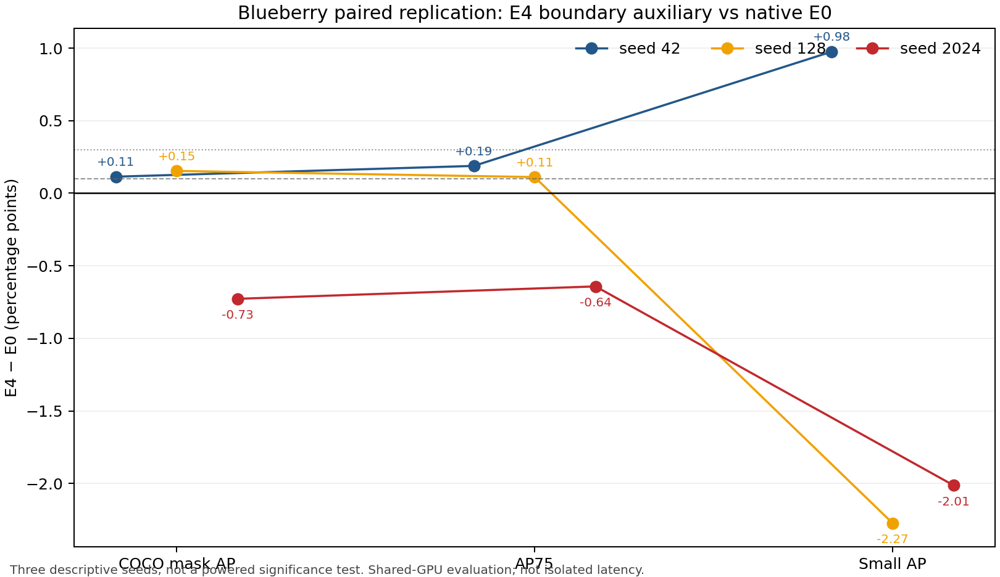
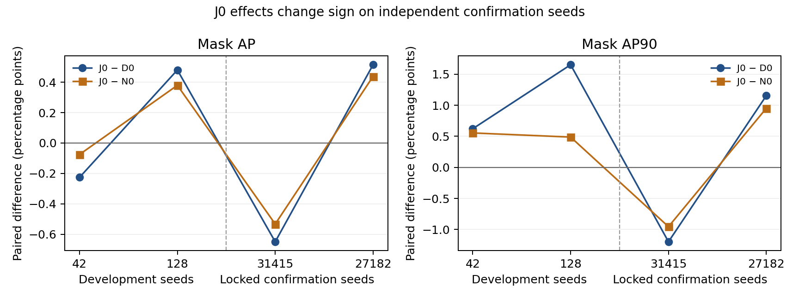

# 从原项目开始读

这份索引由本次整理新增。学习对象是原项目怎样做方法设计、安排实验并形成判断，不需要先运行一个虚构任务。

## 路线一：看一个结构改进怎样落到实验

从 [ENG01 ENGINEERING_CONTRACT](../engineering/eng01_semantic_detail_boundary/ENGINEERING_CONTRACT.md) 开始。它写清了 semantic/detail 来源层、融合位置、边界目标怎样产生、训练期辅助头怎样退出部署，以及 E0–E5 的共同训练条件。对照 [冻结配置](../engineering/eng01_semantic_detail_boundary/configs/frozen.json) 阅读具体参数。

接着看 [SEED42_MATRIX](../engineering/eng01_semantic_detail_boundary/results/SEED42_MATRIX.csv)，逐个对照 E0 原生、E1 detail、E2 MLCA、E3 gate、E4 boundary、E5 gate+boundary。这里可以直接学到：组件不是一个名字，还包括放在哪、接收什么、改变什么、用哪个对照判断它。

最后看 [完整报告](../engineering/eng01_semantic_detail_boundary/FINAL_ENGINEERING_REPORT.md)与[复验表](../engineering/eng01_semantic_detail_boundary/results/REPLICATION_TABLE.csv)。E4 在首个 seed 上有小幅正收益，其他 seed 出现换号；这说明为什么要同时保存首轮筛选和后续复验。不能把首轮最好的数单独摘作方法结果。

## 路线二：看一个研究方向怎样连续推进

按顺序读以下原件，每一步只需回答“上一步暴露了什么，这一步具体改了什么”：

1. [ENG02 错误剖面](../engineering/eng02_scale_capacity_small_object/ERROR_PROFILE_ENG02.md)和[裁决](../engineering/eng02_scale_capacity_small_object/ENG02_VERDICT.md)：容量/输入尺度是否有空间，强教师是否值得做，普通 feature KD 是否有效。
2. [ENG03 方法定义](../engineering/eng03_instance_quality_transfer/METHOD_SPEC.md)：从 feature KD 转向分类、框、mask 输出监督，定义实例对应、质量门控和损失归一化。再看[最终报告](../engineering/eng03_instance_quality_transfer/FINAL_RESEARCH_REPORT.md)，区分实际完成和零 epoch 跳过的候选。
3. [ENG04 证据与方法日志](../engineering/eng04_problem_led_quality_transfer/EVIDENCE_AND_METHOD_LOG.md)及[方法定义](../engineering/eng04_problem_led_quality_transfer/METHOD_SPEC.md)：继续追查教师目标来源、有效监督量和不同任务间的干扰，形成 I0/I1/J0 等设计。
4. [模块组合复盘](../engineering/eng04_problem_led_quality_transfer/analysis/METHOD_COMBINATION_REASSESSMENT_20260930.md)：哪些组合曾经涨过，哪些复杂模块没有超过简单参照，哪些比较跨了训练预算。
5. [最终确认决策](../engineering/eng04_problem_led_quality_transfer/analysis/CONFIRM_J0_V1_DECISION.md)与[四行配对表](../engineering/eng04_problem_led_quality_transfer/analysis/confirm_j0_v1/PAIR_TABLE.csv)：开发结果怎样接受新 seed 检查，以及结论为什么更新。

## 路线三：直接看模块贡献如何拆分

[P1F 实现契约](../diagnostics/p1f_thin_prototype_attribution/FACTORIAL_IMPLEMENTATION_CONTRACT.md)把 source 和 lattice 分成两个因素，另设固定插值与算力控制。[最终报告](../diagnostics/p1f_thin_prototype_attribution/FINAL_REPORT_P1F.md)给出每个变体的部署、局部诊断和成本结果。这是本项目真实做过的归因设计；它没有得出正向方法结论，但实验结构可供借鉴。

[P1D 报告](../diagnostics/p1d_engineering_qualification/FINAL_REPORT.md)则适合看“组合比原始模型高，但新加模块是否必要”：同时比较 M0/M1/M2/M3 与 fresh75，避免只挑较弱参照。

## 借用到自己的研究

选最接近自己问题的原生阶段，沿用它的文件分工；新写自己的问题、方法、数据和结果，具体做法见[架构说明](REPOSITORY_ARCHITECTURE.md)。数值门槛、学习率、seed、模块位置都是历史选择，需要按自己的任务确定，不能把旧配置当通用最优配方。

阅读中看到“原资产，本次未收录”，表示文件只存在于原研究环境。公开版没有相应数据、训练脚本或权重。看到早期 GO、PENDING 或运行状态时，要接着看该阶段最终报告和按日期追加的日志；它们保留了判断发生变化的过程。
